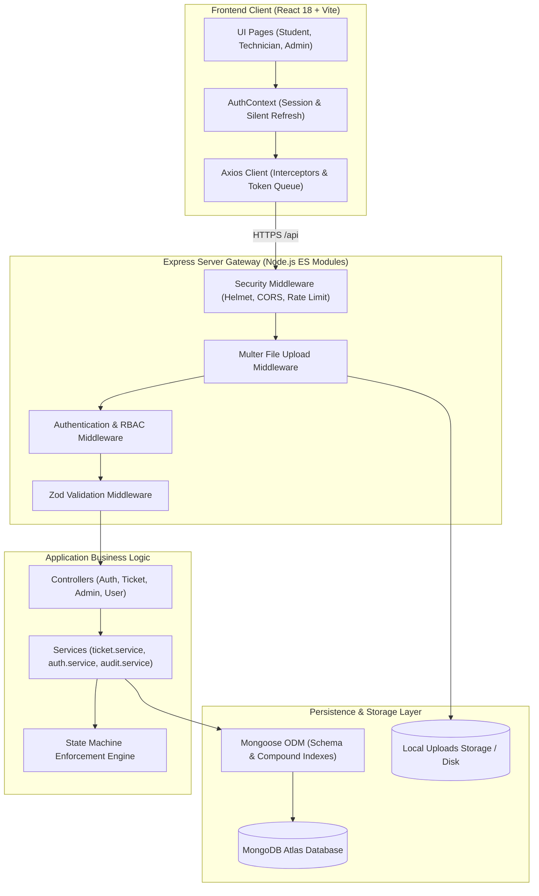
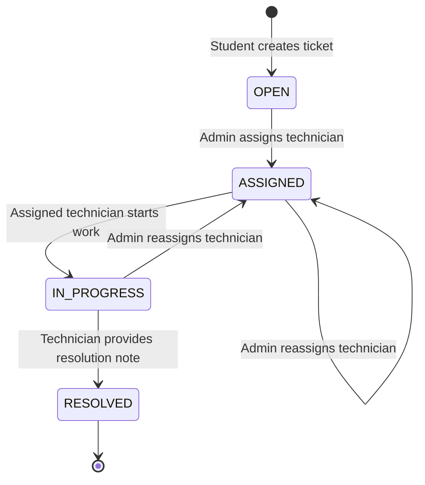

# FixLoop — System Architecture & Design Specification

FixLoop is a responsive campus maintenance and issue management platform designed to help students, technicians, and administrators report, track, assign, and resolve campus facility issues efficiently and securely.

---

## 1. High-Level Architecture Diagram



---

## 2. Layered Architecture Breakdown

### 2.1 Presentation Layer (Frontend)
- **Framework:** React 18, TypeScript, Vite.
- **Styling:** Tailwind CSS with a calm, minimal campus utility aesthetic.
- **Routing:** React Router v6 with `ProtectedRoute` guards checking authentication state and allowed roles (`STUDENT`, `TECHNICIAN`, `ADMIN`).
- **State & Context:** `AuthContext` manages active session state in memory. Silent refresh is executed upon application boot via `POST /api/auth/refresh` using the secure `HttpOnly` refresh token cookie.

### 2.2 Network & Interceptor Layer (`api.ts`)
- Axios client configured with `withCredentials: true` for automatic cookie transmission.
- **Automatic Token Refresh Queue:** When access tokens expire (15-minute TTL), Axios catches `401 Unauthorized` responses and queues concurrent requests while a single refresh request runs. Once refreshed, queued requests are automatically retried with the new access token.
- Infinite retry loops are prevented with retry flags and endpoint exclusions (`/auth/login`, `/auth/refresh`).

### 2.3 Middleware & Gateway Layer
1. **`helmet`:** Injects standard security HTTP headers with `crossOriginResourcePolicy: { policy: 'cross-origin' }` for safe image serving.
2. **`cors`:** Locks access to `CLIENT_ORIGIN` with credentials enabled.
3. **`express-rate-limit`:** 
   - Global API limit: 200 requests / 15 minutes.
   - Dedicated login/registration limit: 5 requests / 15 minutes.
4. **`upload.js`:** Multer disk storage enforcing MIME type (`image/jpeg`, `image/png`, `image/webp`), extension validation (`.jpg`, `.jpeg`, `.png`, `.webp`), and 5MB maximum file size.
5. **`authenticate.js`:** Verifies JWT Bearer tokens and confirms user account is active in the database.
6. **`authorize.js`:** Role-based access control checking `req.user.role`.
7. **`validate.js`:** Pre-execution schema validation using Zod.

### 2.4 Service Layer
- **`ticket.service.js`:** Implements ticket creation, ownership validation, technician assignment, priority updates, and status transitions.
- **`auth.service.js`:** Implements registration, login, token rotation, reuse detection, and session revocation.
- **`audit.service.js`:** Records immutable audit logs for all ticket lifecycle operations.

### 2.5 Data Persistence Layer
- **Mongoose ODM:** Models include `User`, `Category`, `Ticket`, and `AuditLog`.
- **Compound Indexes:** Optimized for high-frequency queries:
  - `{ reportedBy: 1, createdAt: -1 }` (Student personal tickets)
  - `{ assignedTo: 1, status: 1, createdAt: -1 }` (Technician work queue)
  - `{ status: 1, priority: 1, createdAt: -1 }` (Admin queue filtering)

---

## 3. Ticket State Machine Specification



### Transition Validation Rules:
1. `OPEN` can only transition to `ASSIGNED` upon technician assignment by an Admin.
2. `ASSIGNED` can transition to `IN_PROGRESS` only by the assigned technician.
3. `IN_PROGRESS` can transition to `RESOLVED` only by the assigned technician, requiring a mandatory resolution note (minimum 5 characters).
4. Direct jump from `ASSIGNED` to `RESOLVED` is blocked by the backend.
5. Students cannot alter status, priority, or assignment under any circumstance.

---

## 4. File Structure Convention

```
Full Stack 2/
├── package.json              # Monorepo root scripts & workspaces
├── vercel.json               # Frontend SPA rewrite routing
├── render.yaml               # Backend Render deployment blueprint
├── docs/                     # Comprehensive documentation
│   ├── API.md
│   ├── DATABASE.md
│   ├── REQUIREMENTS.md
│   ├── SECURITY.md
│   ├── UI-UX.md
│   ├── TESTING.md
│   ├── DEPLOYMENT.md
│   └── PROJECT_ARCHITECTURE.md
├── backend/
│   ├── package.json
│   ├── .env.example
│   ├── uploads/              # Local storage for uploaded images
│   ├── tests/                # Automated test suites
│   │   ├── db.test.js        # 16 assertions
│   │   ├── auth.test.js      # 36 assertions
│   │   ├── ticket.test.js    # 44 assertions
│   │   ├── upload.test.js    # 17 assertions
│   │   └── e2e.test.js       # 47 assertions
│   └── src/
│       ├── app.js            # Express app configuration & middleware
│       ├── server.js         # Entry point & graceful shutdown
│       ├── config/           # Database & environment configs
│       ├── constants/        # Enums (roles, status, priorities)
│       ├── controllers/      # Route controllers
│       ├── middleware/       # Auth, RBAC, Zod, Multer, Errors
│       ├── models/           # Mongoose schemas (User, Ticket, etc.)
│       ├── routes/           # Express routers
│       ├── scripts/          # Seeder script
│       ├── services/         # Business logic services
│       ├── utils/            # JWT, tokens, error wrappers
│       └── validators/       # Zod schemas
└── frontend/
    ├── package.json
    ├── vite.config.ts        # Vite config with backend proxy (:5001)
    ├── tailwind.config.js
    └── src/
        ├── App.tsx
        ├── main.tsx
        ├── components/       # Common, layout, tickets, feedback
        ├── context/          # AuthContext & state restoration
        ├── hooks/            # useAuth hook
        ├── pages/            # Role-specific dashboard pages
        ├── routes/           # ProtectedRoute & AppRoutes
        ├── services/         # Axios API clients
        └── types/            # TypeScript interfaces & types
```
