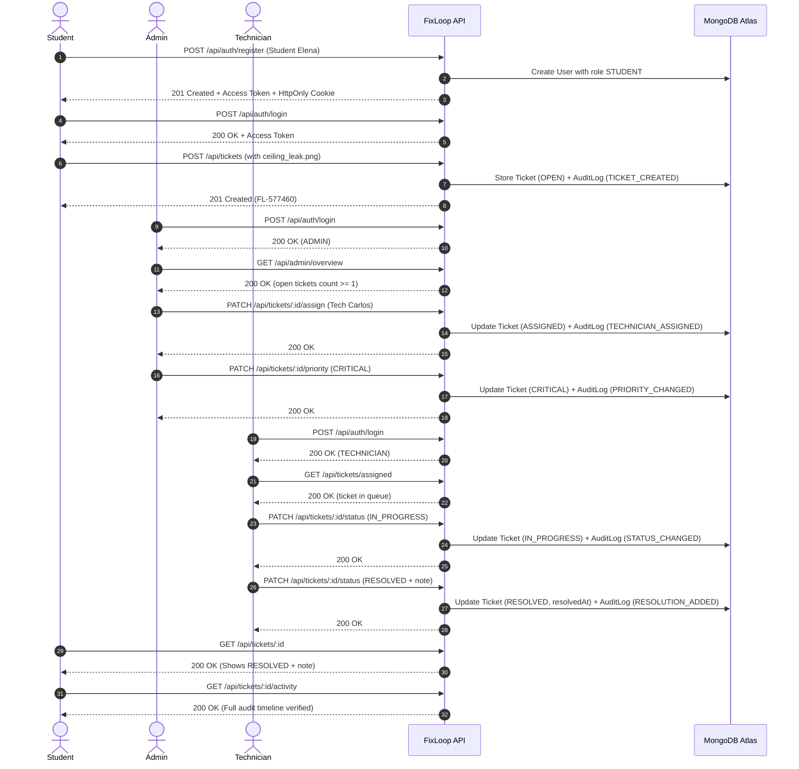

# FixLoop — Testing Strategy & Verification Guide

This document details the automated testing architecture, test suites, coverage areas, and step-by-step verification procedures for FixLoop.

---

## 1. Overview of Automated Test Suites

FixLoop features 5 automated backend integration suites and full frontend static analysis pipelines. All tests run against live MongoDB instances (including MongoDB Atlas).

| Test Suite | File | Focus Area | Assertions | Status |
|---|---|---|---|---|
| **Database & Seeding** | `backend/tests/db.test.js` | Schemas, validations, unique indexes, idempotent seeder, connection lifecycle | 16 | Passed (0 failed) |
| **Auth & RBAC** | `backend/tests/auth.test.js` | Student registration, role isolation, bcrypt hashing, JWT issuance, HttpOnly cookie rotation, reuse detection, logout | 36 | Passed (0 failed) |
| **Ticket Workflow** | `backend/tests/ticket.test.js` | Ticket creation, IDOR ownership rules, technician assignment, priority controls, state machine transitions, resolution notes, audit logging | 44 | Passed (0 failed) |
| **Image Upload Security** | `backend/tests/upload.test.js` | Multipart parsing, MIME & extension whitelisting, 5MB file cap, dangerous extension blocking, disk storage, static serving | 17 | Passed (0 failed) |
| **E2E Scenario** | `backend/tests/e2e.test.js` | Complete end-to-end multi-role lifecycle from registration to resolution and timeline verification | 47 | Passed (0 failed) |
| **Total Automated Assertions** | — | — | **160** | **160 passed, 0 failed** |

---

## 2. Running Test Commands

### 2.1 Backend Tests

Run all test suites sequentially:
```bash
npm test
```

Run specific test suites individually:
```bash
npm run test:db        # Database connection & schema validation tests
npm run test:auth      # Authentication, JWT rotation & RBAC tests
npm run test:tickets   # Ticket lifecycle, assignment & audit tests
npm run test:upload    # Image attachment & file validation security tests
npm run test:e2e       # Full end-to-end multi-role workflow test
```

### 2.2 Frontend Quality Checks

```bash
npm run typecheck      # TypeScript compilation check (tsc --noEmit)
npm run lint           # ESLint static code quality check
npm run build          # Production Vite build
```

---

## 3. End-to-End Scenario Flow (`e2e.test.js`)

The end-to-end automated test verifies the complete cross-role workflow:



---

## 4. Key Verification Scenarios Tested

### 4.1 Authorization & IDOR
- Student A cannot view Student B's tickets via `/api/tickets/my`.
- Student B accessing Student A's ticket directly via `/api/tickets/:id` receives `404 Not Found` (no resource leakage).
- Students cannot access `/api/tickets` (all campus tickets) — returns `403 Forbidden`.
- Students cannot assign technicians or change priority — returns `403 Forbidden`.
- Public registration payload attempting to set `role: "ADMIN"` is sanitized; role defaults strictly to `STUDENT`.

### 4.2 State Machine Transitions
- New tickets start strictly in `OPEN` status.
- Technician assignment transitions status to `ASSIGNED`.
- Technician cannot skip `ASSIGNED` -> `RESOLVED` directly without moving to `IN_PROGRESS` first (returns `400 Bad Request`).
- Resolving ticket without a resolution note (or note < 5 characters) returns `400 Bad Request`.
- Only the assigned technician can update ticket status; other technicians receive `403 Forbidden`.

### 4.3 Refresh Token Security
- Refreshing tokens rotates the token in the database and updates the HttpOnly cookie.
- Replaying an expired or already-rotated refresh token triggers reuse detection, revoking all sessions for that account.
- Calling `/api/auth/logout` revokes the refresh token and clears the cookie.

### 4.4 File Upload Security
- Valid JPEG, PNG, and WebP images upload successfully and are stored with randomized hex names.
- Files exceeding 5MB are rejected with `400 Bad Request`.
- Dangerous file extensions (`.sh`, `.exe`, `.bat`, `.js`) are rejected with `400 Bad Request`.
- Uploaded files are served statically from `/uploads/:filename` with correct MIME headers.
